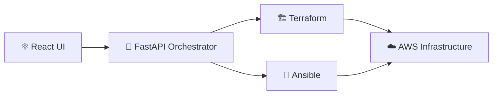

<!-- ============================== HEADER ============================== -->

 

  

 

<!-- ============================== ABOUT ============================== -->
## 👋 About Me

Final-year Computer Engineering student at **ENSA Khouribga (Morocco)**, specializing in **Cloud, Security and Software Engineering**.

I enjoy the space where **software engineering meets infrastructure**: automating provisioning, configuring servers, and shipping applications reliably. My latest project is an **Internal Developer Platform (IDP)** that lets developers deploy applications through a self-service interface, without managing infrastructure by hand.

> 🎯 **Currently looking for a final-year internship (PFE) in Cloud & DevOps**, where I can contribute to real-world projects, learn from experienced engineers, and help build reliable and secure infrastructure.

 

<!-- ============================== FOCUS ============================== -->
## 🧭 Areas of Focus

<table>
<tr>
<td width="33%" valign="top">

**☁️ Cloud** 
AWS, networking, VPC, IAM

**⚙️ Infrastructure as Code** 
Terraform, Ansible

</td>
<td width="33%" valign="top">

**🐳 Containers** 
Docker, Kubernetes

**🔄 CI/CD** 
Git, GitHub Actions

</td>
<td width="33%" valign="top">

**📊 Observability** 
Prometheus, Grafana, Alertmanager

**🔐 DevSecOps** 
Checkov, Trivy, Linux, Bash

</td>
</tr>
</table>

 

<!-- ============================== FLAGSHIP ============================== -->
## ⭐ Flagship Project: Internal Developer Platform

<table>
<tr>
<td>

**tekKnow · Final-Year Engineering Project**

A self-service platform that simplifies the deployment of **three-tier applications on AWS**. It connects infrastructure provisioning with automated configuration management through an orchestration layer.

**What I built**

- 🏛️ Architecture linking a React frontend to a FastAPI orchestration backend
- 🏗️ AWS provisioning with Terraform (VPCs, public/private subnets, EC2, environment isolation)
- 🔧 Server configuration and app deployment with Ansible
- 🔗 Terraform + Ansible integrated into one coordinated deployment workflow
- 🧭 Dynamic inventory and SSH-based access for configuration management
- 🔑 AWS Secrets Manager for application and database credentials
- 🛡️ Security and vulnerability scanning exploration with Checkov and Trivy

  
  
  
  
  
  
  

</td>
</tr>
</table>

 

<!-- ============================== EXPERIENCE ============================== -->
## 💼 Experience

| | Role | Highlights |
|---|---|---|
| **2025 – 2026** tekKnow | **Cloud & DevOps Engineering** Final-Year Project | Internal Developer Platform on AWS with Terraform, Ansible, FastAPI and React |
| **Aug – Sep 2024** OCP Group Benguerir | **Software Development Engineer Intern** | Built an on-call management web app from scratch with Laravel; requirements analysis, design and implementation using MVC [🔗 View repository](https://github.com/MohammedBentimzal/Projet_gestion_d-Astreinte_OCP) |
| **Apr 2023 – Jan 2025** Startgate / GetCata Benguerir | **Content Operations Specialist** | Worked with cross-functional teams and developers on content integration, UX and content organization |

 

<!-- ============================== PROJECTS ============================== -->
## 🚀 More Projects

<table>
<tr>
<td width="50%" valign="top">

### 🤖 SEO-op
**SEO & AI Agent SaaS**

Two services in one platform: SEO optimization tools, and an AI chatbot trained on the user's own files that can be embedded in any website with a simple script.

`SaaS` `SEO` `AI Agents` `Chatbots`

[🔗 View project](https://github.com/MohammedBentimzal/SEO-op)

</td>
<td width="50%" valign="top">

### 🏥 Medical Cabinet Management
Web app for managing patient records, appointments and doctor workflows.

`Spring Boot` `Next.js` `MySQL`

[🔗 View project](https://github.com/MohammedBentimzal/medical-cabinet)

</td>
</tr>
<tr>
<td width="50%" valign="top">

### 🛍️ Clothing E-commerce Platform
Product catalog, shopping cart, order management and admin dashboard.

`Laravel` `MySQL` `Bootstrap`

[🔗 View project](https://github.com/MohammedBentimzal/Plateforme_E-commerce_Pret_a_Porter)

</td>
<td width="50%" valign="top">

### 🧠 Prim's Algorithm Visualizer
Interactive app to explore minimum spanning trees through graph visualization and step-by-step explanations.

`React` `Flask` `Python` `Graph Theory`

[🔗 View project](https://github.com/MohammedBentimzal/Prim_algo_project)

</td>
</tr>
<tr>
<td width="50%" valign="top">

### 🏭 OCP On-Call Management
Web app to manage on-call schedules and organize operational responsibilities.

`Laravel` `PHP` `MySQL`

[🔗 View project](https://github.com/MohammedBentimzal/Projet_gestion_d-Astreinte_OCP)

</td>
<td width="50%" valign="top">

</td>
</tr>
</table>

 

<!-- ============================== SKILLS ============================== -->
## 🛠️ Tech Stack

**☁️ Cloud & Infrastructure** 

**🐳 Containers & Orchestration** 

**🔄 CI/CD & Version Control** 

**📊 Monitoring** 

**🔐 DevSecOps** 

**💻 Languages** 

**🧩 Backend & Frontend** 

**🗄️ Databases & Data** 

 

<!-- ============================== GITHUB STATS ============================== -->
## 📈 GitHub Activity

 

<!-- ============================== LEADERSHIP ============================== -->
## 🏆 Leadership & Activities

- 📢 **Conferences & Workshops Manager** · OpenSource Days, ENSA Khouribga: organized technical talks and coordinated sessions with industry speakers
- 🎨 **Media & Design Lead** · EPIC ENSAK Club: led design activities and contributed to humanitarian initiatives
- 🤝 **Health Event Organizer** · Ataa & Alyakouta Associations: helped organize a three-day event (logistics and team coordination)

 

## 🌍 Languages

 

<!-- ============================== FOOTER ============================== -->

## 🤝 Let's Connect

I'm always happy to talk about cloud infrastructure, DevOps practices, automation and innovative software projects.

**Open to PFE internships in Cloud & DevOps Engineering.**

ENSA Khouribga · Morocco · Expected graduation: June 2027

